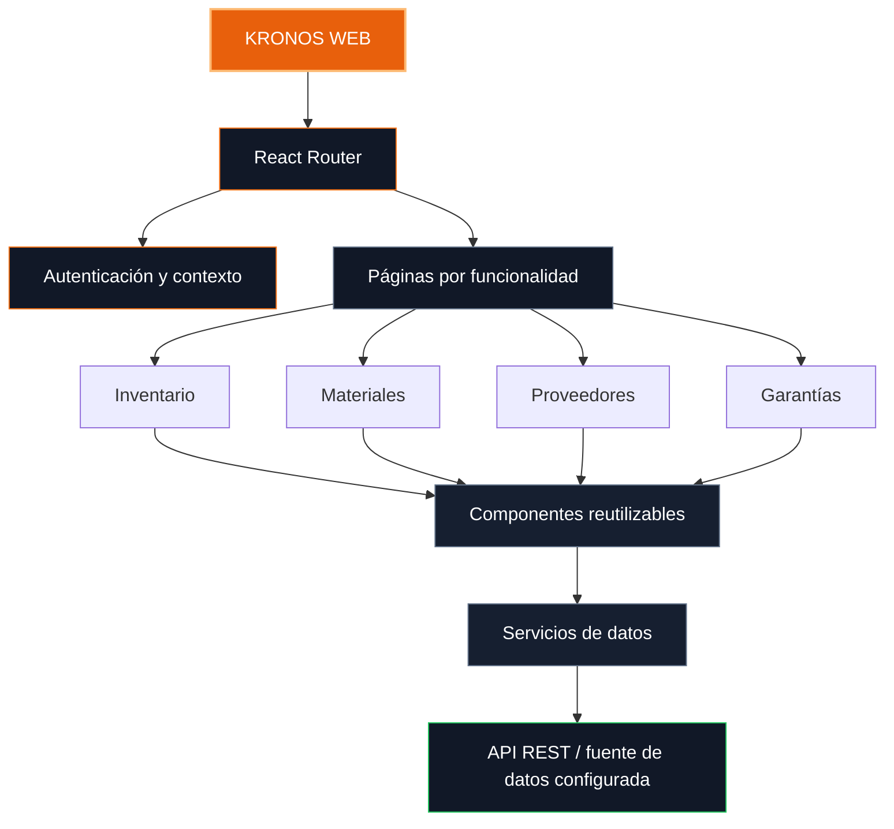
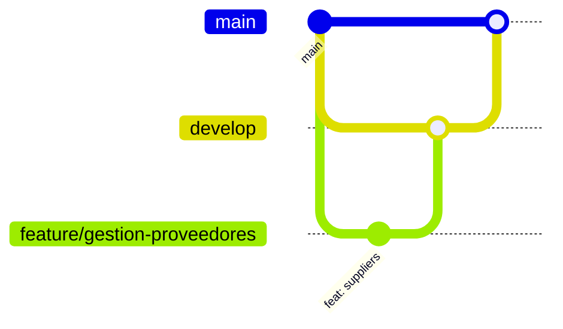

 <div align="center">


<br/>


<br/><br/>


</div>

---

<div align="center">

**THE INTERFACE BEHIND THE INVENTORY.**

La experiencia web de KRONOS Inventory Control, diseñada para organizar las operaciones de Ferretería y Perfilería Solmet mediante una interfaz moderna, intuitiva y adaptable.

</div>

##  Sobre el frontend

El frontend de **KRONOS Inventory Control (KIC)** es la capa de presentación del sistema de gestión de inventario. Está desarrollado con React y Vite, y organiza las interfaces mediante componentes reutilizables y vistas orientadas a las funcionalidades del negocio.

Su propósito es facilitar la interacción de los usuarios con el sistema, ofreciendo espacios de trabajo diferenciados para la gestión del inventario, los materiales, los proveedores, las órdenes de compra y las garantías.

La aplicación se desarrolla con una identidad visual basada en tonos oscuros, detalles naranjas y una distribución enfocada en la claridad de la información.

> **Design with purpose. Build with structure. Manage with KRONOS.**

##  Tecnologías utilizadas

<div align="center">

| Tecnología | Aplicación |
|:--|:--|
|  **React** | Construcción de interfaces mediante componentes. |
|  **Vite** | Servidor de desarrollo y compilación. |
|  **JavaScript** | Lógica e interactividad de la aplicación. |
|  **Bootstrap** | Diseño adaptable y componentes de interfaz. |
| **Bootstrap Icons** | Iconografía de las vistas y controles. |
| **React Router** | Navegación entre páginas y áreas de la aplicación. |
| **Axios** | Comunicación HTTP con servicios, cuando se utiliza. |
| **SweetAlert2** | Alertas, confirmaciones y mensajes visuales. |
| **DataTables** | Organización de tablas y herramientas de consulta. |

</div>

La configuración efectiva de las dependencias debe verificarse en `package.json` y en el código actual del repositorio.

##  Áreas funcionales

<table>
<tr>
<td width="50%" valign="top">

### 

**Inventario**

- Consulta de existencias.
- Visualización de movimientos.
- Entradas y salidas.
- Indicadores de stock.
- Alertas de disponibilidad.

</td>
<td width="50%" valign="top">

### 

**Materiales y clasificación**

- Consulta de materiales.
- Organización por categorías.
- Gestión de marcas, según el alcance implementado.
- Formularios de registro y actualización.

</td>
</tr>
<tr>
<td width="50%" valign="top">

### 

**Proveedores y órdenes de compra**

- Consulta y registro de proveedores.
- Tablas de información.
- Gestión de órdenes de compra.
- Seguimiento de estados.

</td>
<td width="50%" valign="top">

### 

**Garantías**

- Consulta de solicitudes.
- Registro de información.
- Seguimiento de estados.
- Presentación de evidencias, cuando esté disponible.

</td>
</tr>
</table>

Estas áreas describen el alcance funcional del frontend. La disponibilidad de cada operación depende de su implementación y de los servicios conectados.

##  Diseño e interfaz

La identidad visual de KRONOS utiliza una estética tecnológica e industrial, con componentes que priorizan la legibilidad, la organización y la consistencia.

<div align="center">

| Elemento | Estilo |
|:--|:--|
| Fondo principal | `#0B0F19` |
| Superficies y paneles | `#111827` |
| Superficies secundarias | `#161F30` |
| Color de acento | `#E8600C` |
| Estados positivos | `#22C55E` |
| Tipografía de títulos | Oswald |
| Tipografía de interfaz | Inter |

</div>

### Principios de interfaz

- **Consistencia:** mantener los mismos estilos en formularios, tablas, botones y paneles.
- **Jerarquía visual:** destacar la información importante sin saturar la pantalla.
- **Reutilización:** construir componentes que puedan utilizarse en diferentes vistas.
- **Claridad:** mostrar mensajes y estados que ayuden al usuario a comprender cada operación.
- **Adaptabilidad:** procurar que la interfaz funcione en diferentes tamaños de pantalla.

##  Organización del frontend

La aplicación se estructura alrededor de componentes, páginas, navegación y servicios de acceso a datos.



*Diagrama conceptual: la fuente de datos definitiva depende de la configuración vigente del proyecto.*

### Gestión del estado de sesión

El proyecto contempla un contexto de autenticación para centralizar la información de la sesión y del perfil.

Entre los elementos utilizados en la estructura de autenticación se encuentran:

- `AuthContext.jsx`: contexto de autenticación.
- `sesion`: información relacionada con la sesión.
- `perfil`: datos del perfil del usuario.
- `cargandoSesion`: estado de carga de la sesión.

Estos elementos deben mantenerse sincronizados con el mecanismo de autenticación y la fuente de datos efectivamente configurados.

##  Navegación y roles

KRONOS contempla espacios de trabajo diferenciados para los siguientes perfiles:

| Rol | Área |
|:--|:--|
| `admi` | Administración. |
| `jefe` | Supervisión y gestión interna. |
| `prove` | Portal del proveedor. |
| `cli` | Portal del cliente. |

### Rutas de referencia

| Ruta | Funcionalidad |
|:--|:--|
| `/proveedor/ordenes` | Órdenes de compra del proveedor. |
| `/cliente/pedidos` | Pedidos del cliente. |
| `/cliente/garantias` | Garantías del cliente. |

Las rutas anteriores corresponden a las rutas conocidas del proyecto y pueden ampliarse según la configuración actual de React Router.

**Importante:** ocultar una página en el frontend no sustituye la autorización del backend. Las operaciones protegidas deben validarse también en el servidor.

##  Estructura del proyecto

Una organización de referencia para el frontend es la siguiente:

```text
KRONOS-Frontend/
│
├── public/
│   └── assets/
│
├── src/
│   ├── assets/
│   │
│   ├── components/
│   │   ├── common/
│   │   ├── forms/
│   │   └── tables/
│   │
│   ├── layouts/
│   │
│   ├── pages/
│   │   ├── inventario/
│   │   ├── materiales/
│   │   ├── proveedores/
│   │   ├── ordenes/
│   │   └── garantias/
│   │
│   ├── context/
│   │   └── AuthContext.jsx
│   │
│   ├── services/
│   │
│   ├── routes/
│   │
│   ├── App.jsx
│   └── main.jsx
│
├── .env.example
├── .gitignore
├── index.html
├── package.json
├── vite.config.js
└── README.md
```

Esta estructura es orientativa. Los nombres y las carpetas definitivos deben coincidir con los archivos reales del repositorio.

##  <a id="instalacion"></a>Instalación y ejecución

### Requisitos previos

- Node.js compatible con la versión de Vite del proyecto.
- npm.
- Git.
- Acceso al repositorio del frontend.

### 01. Clonar el repositorio

```bash
git clone <URL_DEL_REPOSITORIO_FRONTEND>
cd <CARPETA_DEL_FRONTEND>
```

### 02. Instalar dependencias

```bash
npm install
```

### 03. Configurar las variables de entorno

Si la aplicación utiliza variables de entorno, crea un archivo `.env` a partir de la configuración de ejemplo y completa los valores necesarios.

Por ejemplo, si la aplicación consume una API REST:

```env
VITE_API_URL=http://localhost:3000/api
```

La URL es un ejemplo: debe reemplazarse por la dirección real del backend. Si el proyecto utiliza otra configuración, conserva los nombres de variables que espera el código.

**No publiques credenciales privadas, claves secretas ni tokens en GitHub.** Las variables con prefijo `VITE_` quedan expuestas al código del navegador y no deben contener secretos.

### 04. Iniciar el servidor de desarrollo

```bash
npm run dev
```

Abre la dirección local que Vite muestre en la terminal.

### 05. Compilar para producción

```bash
npm run build
```

Para previsualizar la compilación:

```bash
npm run preview
```

##  Integración con los servicios

El frontend necesita una fuente de datos configurada para realizar las operaciones que requieren persistencia.

La integración debe respetar las responsabilidades de cada capa:

1. Los componentes presentan los datos y reciben las acciones del usuario.
2. Los servicios ejecutan las consultas o solicitudes necesarias.
3. La API o el servicio de datos valida y procesa las operaciones.
4. La interfaz actualiza su estado y presenta el resultado.

Si se utiliza una API REST, se recomienda centralizar las solicitudes HTTP en servicios reutilizables, en lugar de repetir las mismas llamadas en múltiples componentes.

La conexión definitiva debe documentarse de acuerdo con el entorno activo, ya sea el backend propio, una fuente de datos de desarrollo u otro servicio configurado.

##  Buenas prácticas

- Mantener los componentes pequeños y con responsabilidades claras.
- Reutilizar los formularios y elementos visuales compartidos.
- Separar la presentación de las operaciones de datos.
- Validar los formularios antes de enviar información.
- Mostrar estados de carga, éxito y error.
- Evitar duplicar la lógica de autenticación.
- Proteger las variables de entorno.
- Mantener las dependencias y los scripts actualizados.
- Utilizar nombres claros y consistentes para componentes, funciones y archivos.

##  Control de versiones

El desarrollo se organiza mediante Git y GitHub, con ramas orientadas a las funcionalidades.



### Ejemplos de commits

```bash
git commit -m "feat(proveedores): actualizar vista de proveedores"
git commit -m "fix(auth): corregir estado de sesión"
git commit -m "style(inventario): mejorar diseño de tabla"
git commit -m "docs(frontend): actualizar README"
```

Se recomienda integrar los cambios después de revisar su funcionamiento y mantener las ramas sincronizadas con el repositorio remoto.

##  Evolución del frontend

| Área | Objetivo |
|:--|:--|
| Interfaz | Mantener una experiencia visual consistente. |
| Navegación | Organizar las rutas y los accesos por perfil. |
| Inventario | Consolidar las vistas y operaciones de stock. |
| Proveedores | Integrar las operaciones de proveedores y órdenes. |
| Garantías | Consolidar el seguimiento de solicitudes. |
| Integración | Conectar las vistas con los servicios configurados. |
| Calidad | Verificar validaciones, estados y manejo de errores. |
| Documentación | Mantener actualizadas las instrucciones técnicas. |

El estado de cada elemento debe actualizarse con base en su implementación y las pruebas realizadas.

##  Equipo

<div align="center">

**SENA · ADSO · Ficha 3315796**

| Integrante | Área de trabajo |
|:--|:--|
| Mariana Martínez | Proveedores y órdenes de compra |
| Erick Vásquez | Materiales y clasificación |
| Manuel Vigoya | Inventario, entradas, salidas y alertas |
| Evert Arias | Inventario, entradas, salidas y alertas |
| David Villanueva | Garantías |

</div>

---

<div align="center">


<br/><br/>


**KRONOS FRONTEND**

<sub>React · Vite · Inventory Control · SENA ADSO</sub>

<sub>One interface. Every operation. Better control.</sub>

</div>